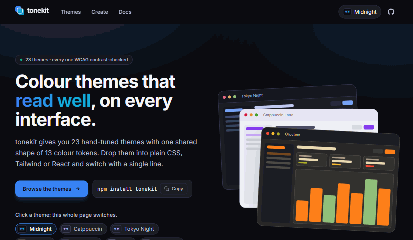
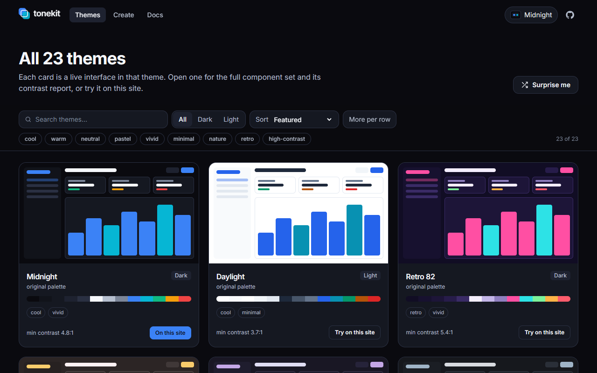
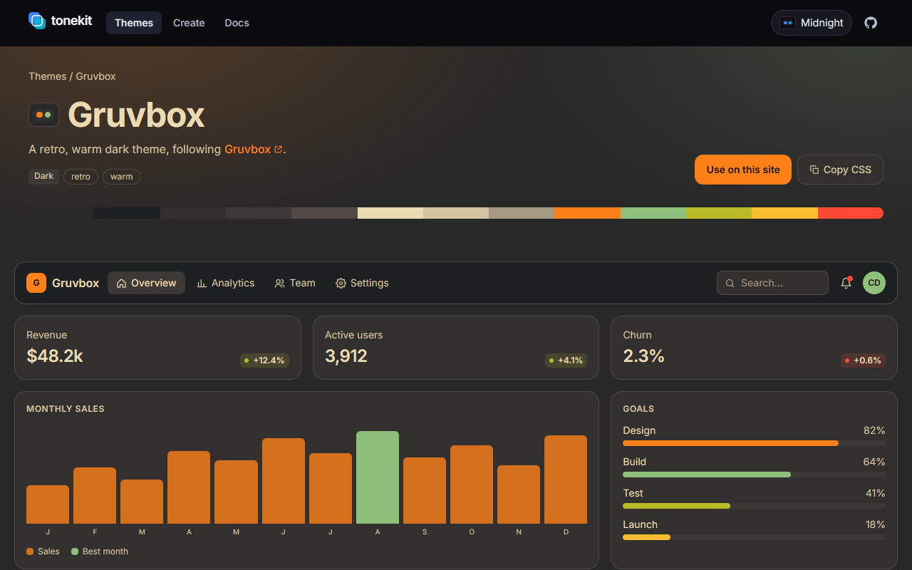

<div align="center">

# tonekit

**23 contrast-checked colour themes for any interface.**

Catppuccin, Nord, Tokyo Night, Gruvbox, Rosé Pine and more, all sharing one shape of 13 colour tokens and all meeting WCAG contrast targets. Use them as plain CSS variables, with Tailwind, or with a React provider and theme picker.

[](https://www.npmjs.com/package/tonekit-themes)
[](https://github.com/chahe-dridi/tonekit/actions/workflows/ci.yml)
[](https://github.com/chahe-dridi/tonekit/blob/main/LICENSE)

**[Live site](https://tonekit-gamma.vercel.app)** · **[All themes](https://tonekit-gamma.vercel.app/themes)** · **[Theme builder](https://tonekit-gamma.vercel.app/create)** · **[Docs](https://tonekit-gamma.vercel.app/docs)**



</div>

---

## Features

- **23 themes.** Midnight, Daylight, Catppuccin (Mocha and Latte), Nord, Tokyo Night, Gruvbox, Rosé Pine, Everforest, Kanagawa, Flexoki, Ristretto, Miasma, and originals like Retro 82, Lumon, Osaka Jade and Hackerman.
- **Contrast-checked.** Every theme meets 9 WCAG targets (body text 7:1, links 4.5:1, button text 4.5:1…). The test suite fails if one slips.
- **One shape.** The same 13 tokens everywhere, so switching themes is a one-line change.
- **Use it your way.** A plain stylesheet with `data-theme`, a Tailwind CSS v4 preset, a React `ThemeProvider` and accessible `ThemePicker`, or framework-free functions.
- **No flash.** A tiny inline script applies the saved theme before the first paint.
- **Make your own.** `defineTheme()` turns your brand colours into a full theme; the [builder](https://tonekit-gamma.vercel.app/create) fixes contrast for you.
- **Small.** About 6 kB gzipped with every theme, zero runtime dependencies, TypeScript types included.

<p align="center">
  
  
</p>

## Install

```bash
npm install tonekit-themes
```

## Plain CSS

```css
@import "tonekit-themes/themes.css";

.card {
  background: var(--theme-surface);
  color: var(--theme-text);
  border: 1px solid var(--theme-border);
}
.button {
  background: var(--theme-primary);
  color: var(--theme-on-primary);
}
```

```html
<html data-theme="tokyo-night">
```

Without `data-theme`, the page follows the visitor's light or dark setting.

## React

```jsx
import { ThemeProvider, ThemePicker, ThemeScope, useTheme } from 'tonekit-themes/react'

export default function App() {
  return (
    <ThemeProvider defaultTheme="system" dark="tokyo-night" light="catppuccin-latte">
      <ThemePicker />
      <Page />
      <ThemeScope theme="gruvbox">{/* this part always uses Gruvbox */}</ThemeScope>
    </ThemeProvider>
  )
}
```

`useTheme()` returns `{ theme, themeId, setTheme, followSystem, themes, preview, endPreview }`.

## Tailwind CSS v4

```css
@import "tailwindcss";
@import "tonekit-themes/tailwind.css";
```

```html
<div class="rounded-xl border border-border bg-surface p-6 text-text">
  <p class="text-muted">Follows the active theme.</p>
  <button class="bg-primary text-on-primary">Save</button>
</div>
```

## JavaScript

```js
import { applyTheme, saveTheme, resolveTheme, checkTheme, defineTheme } from 'tonekit-themes'

applyTheme(resolveTheme())   // saved choice, or the OS default
saveTheme('nord')            // or saveTheme('system')
checkTheme('nord').pass      // true

const brand = defineTheme({ id: 'brand', base: 'midnight', colors: { primary: '#ff5a5f' } })
```

`noFlashScript()` returns an inline `<head>` script that applies the saved theme before first paint. The full API is in the [docs](https://tonekit-gamma.vercel.app/docs#api).

## Tokens

| Token | Use |
| --- | --- |
| `bg`, `bgAlt` | page and alternate section backgrounds |
| `surface`, `surfaceAlt` | cards and panels, raised or hovered surfaces |
| `border` | hairlines and outlines |
| `text`, `textMuted`, `textSubtle` | body text (7:1), secondary text (4.5:1), captions (3:1) |
| `primary`, `accent` | links and actions (4.5:1), highlights (3:1) |
| `success`, `warning`, `danger` | status colours |

Each becomes `--theme-<name>` (kebab-case), plus `--theme-on-primary`, `-on-accent`, `-on-success`, `-on-warning`, `-on-danger` and `-rgb` triples for tints.

## Repository layout

```
packages/tonekit   the npm package: themes, helpers, React bindings, CSS
apps/site          the showcase site (Vite, React, Tailwind CSS)
scripts            release and README media
```

## Development

```bash
npm install
npm run dev       # the site, hot-reloading the library from source
npm test          # library tests, including every theme's contrast
npm run build     # library + site
npm run media     # re-record the README GIF and screenshots (needs Chrome)
```

## Versioning and releases

[Semantic Versioning](https://semver.org); changes are listed in [CHANGELOG.md](https://github.com/chahe-dridi/tonekit/blob/main/CHANGELOG.md). `npm run release -- patch|minor|major` bumps the version and tags it; pushing the tag publishes to npm from GitHub Actions.

## Contributing

New themes and fixes are welcome. Branch off `dev` and open your pull request **against `dev`** (`main` only receives tested merges for releases). See [CONTRIBUTING.md](https://github.com/chahe-dridi/tonekit/blob/main/CONTRIBUTING.md).

## Credits

Palettes that follow published themes are credited on each [theme page](https://tonekit-gamma.vercel.app/themes): Catppuccin, Rosé Pine, Tokyo Night, Nord, Gruvbox, Everforest, Kanagawa, Flexoki, Monokai Pro and Miasma. Thank you to their authors.

## License

[MIT](https://github.com/chahe-dridi/tonekit/blob/main/LICENSE) © Chaher Dridi
